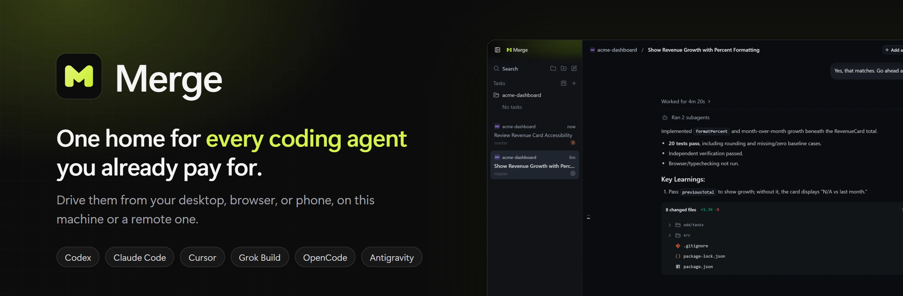
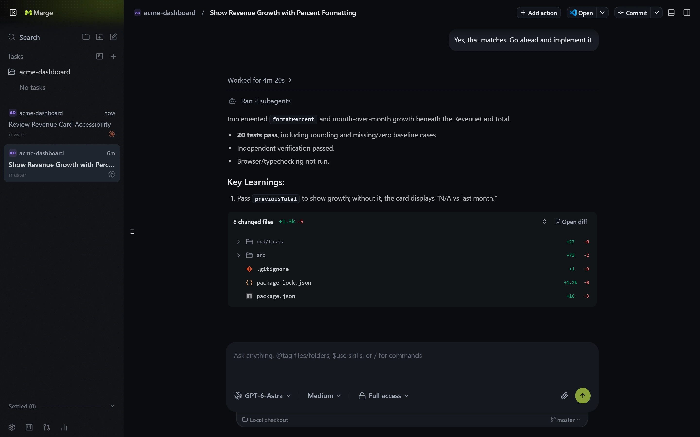
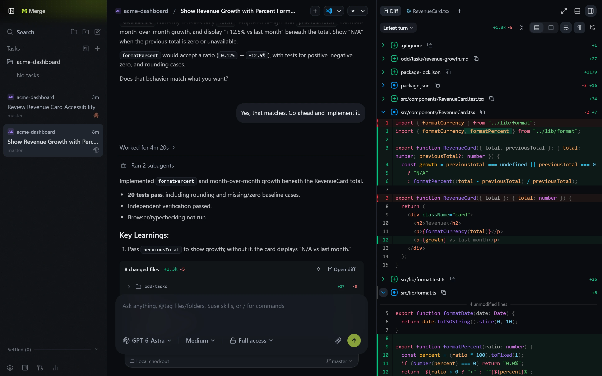
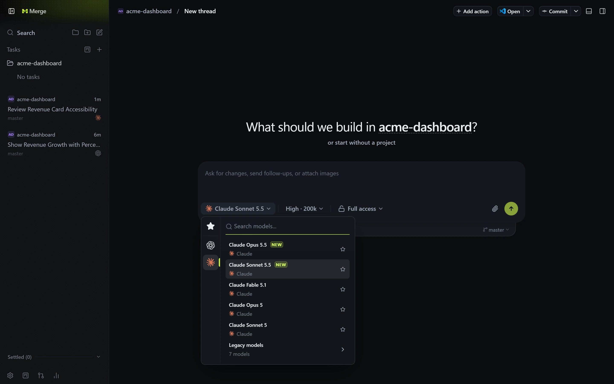
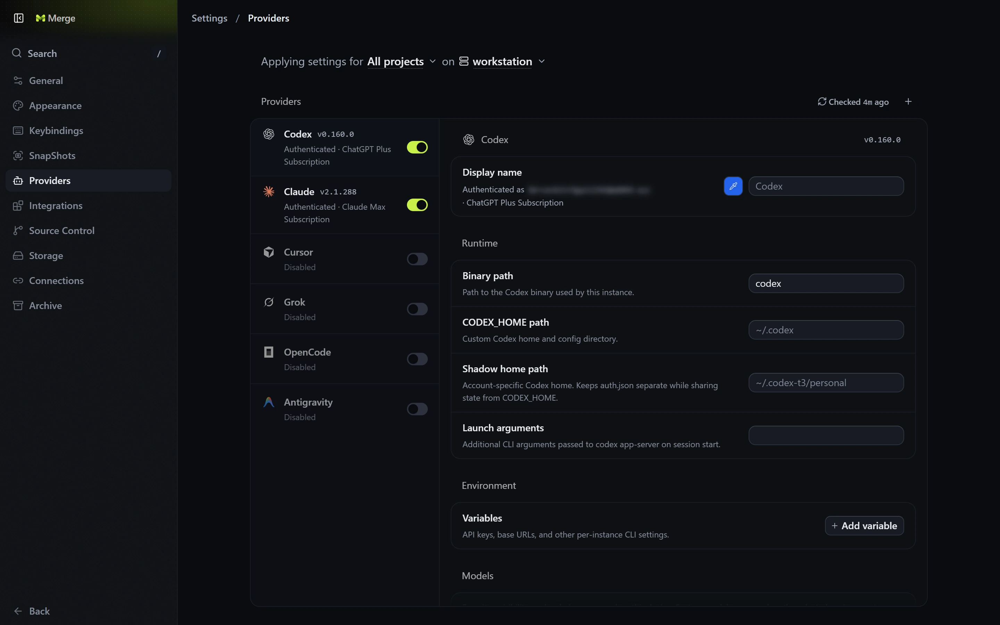

<!-- merge-seam: readme-fork -->

  

# Merge

Merge is a desktop, web, and mobile control surface for the coding agents on your machine. It works with your existing subscriptions to Claude Code, Codex, Cursor, Grok Build, OpenCode, and Google Antigravity: if they are set up on your computer, Merge can drive them.

> [!NOTE]
> Merge is a fork of [T3 Code](https://github.com/pingdotgg/t3code) by T3 Tools, released under the MIT License. Most of the code is theirs. The fork rebrands it, adds its own features (task and thread links, sidebar folders, Azure DevOps source control), and ships its own builds from [GitHub Releases](https://github.com/jonathanfernandezfm/merge/releases). Hosted T3 services (Connect, relay, hosted web app) are not part of Merge. How the fork tracks upstream is described in [fork/SYNC.md](./fork/SYNC.md).

## A quick look

Agents work in threads, grouped by project. Each turn ends with a summary of what changed.

Review every turn's diff next to the conversation, then commit from the same window.

Switch providers and models per thread.

Turn providers on or off, and point each at its own binary, home directory, and environment.

## Prerequisites

Install and authenticate at least one provider on the machine that will run the agents:

- Codex: install [Codex CLI](https://developers.openai.com/codex/cli) and run `codex login`
- Claude: install [Claude Code](https://claude.com/product/claude-code) and run `claude auth login`
- Cursor: install [Cursor CLI](https://cursor.com/cli) and run `agent login`
- Grok Build: install [Grok Build CLI](https://x.ai/cli) and run `grok login`
- OpenCode: install [OpenCode](https://opencode.ai) and run `opencode auth login`
- Antigravity: enable it in Settings, then use **Install Antigravity** and **Sign in with Google**. No CLI is required.

## Install

Download the installer for your platform from [GitHub Releases](https://github.com/jonathanfernandezfm/merge/releases): `.exe` (Windows), `.dmg` (macOS), `.AppImage` or `.deb` (Linux). The desktop app updates itself from the same releases.

Release builds may be unsigned:

- **macOS:** if Gatekeeper refuses to open the app, right-click it and choose **Open**, or allow it in **System Settings → Privacy & Security**.
- **Windows:** if SmartScreen blocks the installer, choose **More info → Run anyway**.

Merge keeps its data in `~/.merge`.

## Build from source

1. Install [Vite+](https://viteplus.dev/guide/), which provides the `vp` command:
   - macOS / Linux: `curl -fsSL https://vite.plus | bash`
   - Windows: `irm https://vite.plus/ps1 | iex`
2. Install dependencies: `vp i`
3. Start the server and web app: `vp run dev` (or `vp run dev:desktop` for the desktop app)

## Documentation

Guides live in [docs/](./docs). They are inherited from T3 Code, so product names and install commands in them may still say T3 Code.

- [Install and first run](./docs/user/install.md)
- [Remote access](./docs/user/remote-access.md)
- [Updating](./docs/user/updating.md)
- [All user guides](./docs/README.md)
- [Architecture overview](./docs/internals/overview.md)
- [Syncing the fork with upstream](./fork/SYNC.md)

Read [CONTRIBUTING.md](./CONTRIBUTING.md) before opening a PR.
